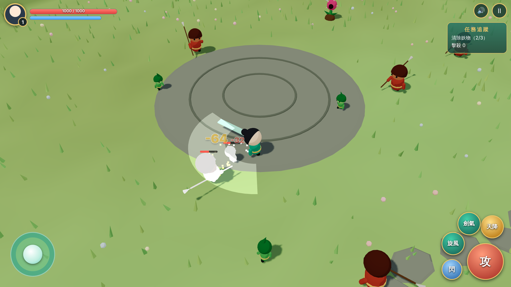
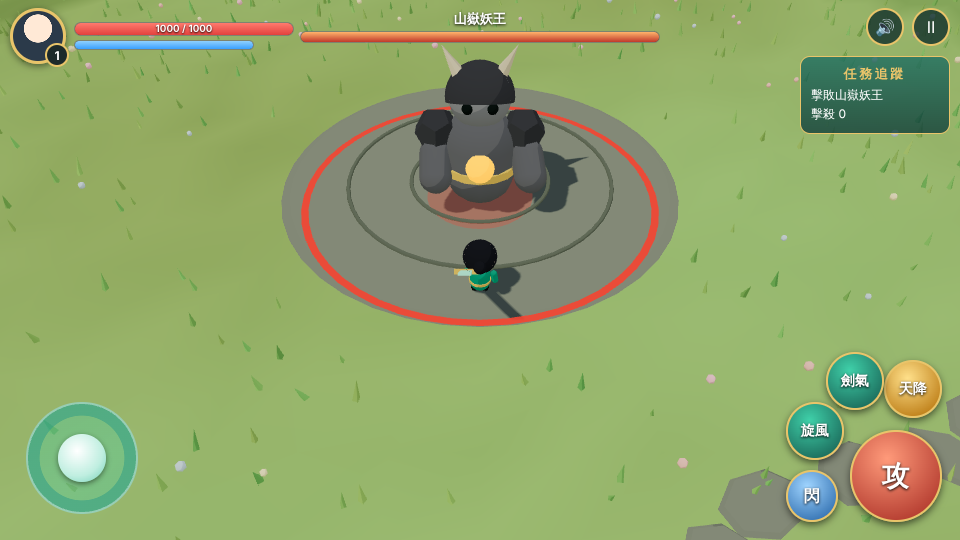

# 第二款遊戲（3D 仙俠戰鬥）：參考影片分析、交 GPT 的素材需求、佔位版原型（2026-11-10，Claude）

## 使用者要求
- 分析一支參考影片的戰鬥場景：要做的物件、技術需求、Claude 能否克服、3D 用什麼方法。
- 之後確認：BGM 與配音由使用者處理；美術圖需求開給 GPT；3D 模型打算走 Tripo。

## 本次完成內容
- 看過參考影片（28 秒、1280×720，抽幀檢視）。內容是斜俯視 3D 即時動作砍殺；UI 整段沒有變化，屬於靜態圖層疊在戰鬥錄影上。
- 新增素材需求清單：[`02_xianxia_battle/assets/ASSETS.md`](../../02_xianxia_battle/assets/ASSETS.md)。
- 使用者後續要求「先把環境建立好」「需要 3D 就用 3D」「特效要 3D」，因此建立了**可玩的佔位版原型**：[`02_xianxia_battle/`](../../02_xianxia_battle/)，功能與檔案見 [`PROGRESS.md`](../../02_xianxia_battle/PROGRESS.md)。
- 原型內所有角色、場景、UI、音效都是程式產生的佔位物；**沒有任何正式美術、模型或音樂**。資料夾名為工作代號，遊戲尚未定名。
- 素材插槽 `assets/manifest.json`：填入 GLB／音樂路徑即可替換佔位物，格式見 [`assets/README.md`](../../02_xianxia_battle/assets/README.md)。
- 需求清單 §8 已改為「特效由 Claude 以 3D 製作，GPT 只供貼圖」。
- Three.js r170（MIT）與 GLTFLoader 放在 `02_xianxia_battle/vendor/three/`，約 840KB，無建置步驟。

## 驗證（無頭 Chromium＋軟體 WebGL，2026-11-10）
- 啟動、開始、三波小怪、Boss、勝利結算、重來、落敗結算：皆通過，console 無錯誤。
- 自動打怪腳本從第一波打到第三波（擊殺 32）無錯誤；Boss 戰另以測試掛鉤直接跳關驗證。
- GLB 替換流程：以 three.js 範例的 RobotExpressive.glb 臨時測試，主角與小怪成功換成骨架動畫模型；指向不存在的檔案時退回佔位角色。測試檔未提交。
  - 過程中修正一個錯誤：蒙皮模型要先更新世界矩陣再算包圍盒，否則縮放比例會錯。
- 版面：1280×720、844×390（手機橫式）、390×844（直式）截圖檢查，按鈕無重疊。
- **未驗證**：實體手機的觸控手感與幀率（無頭環境是軟體繪圖，無法代表手機效能）、音訊實際聽感、多點觸控同時搖桿＋按鍵。
- 截圖： 

## 已定的分工
| 項目 | 負責 | 狀態 |
|------|------|------|
| 遊戲程式、戰鬥、AI、鏡頭、3D 特效、3D 場景 | Claude | 佔位版原型已完成 |
| 3D 角色模型＋骨架＋動作 | Claude 經 Tripo API | 等使用者提供 API 金鑰與設定圖 |
| 角色設定圖、UI、圖示、數字、字藝、背景 | GPT／Codex（使用者把關品質；設定圖使用者也可能自己做） | 需求已開，未產出 |
| BGM、配音 | 使用者 | 未交付 |
| 音效 | Claude 程式合成佔位 | 已有佔位版 |

## 技術方向
- Three.js，放在現有靜態網站內；手機橫式 16:9。
- 角色：設定圖 → Tripo 圖轉 3D → 自動綁骨與預設動作 → GLB。非人形怪與專屬動作用程式動畫補。
- 場景用程式生成加 CC0 素材；特效全用程式。
- 備案：3D 角色品質不足時退到 2.5D（3D 場景＋2D 角色 sprite）。

## 環境實測（2026-11-10，本雲端環境）
- `api.tripo3d.ai` 可連（未帶金鑰回 401）；`www.tripo3d.ai` 網站回 403，無法從這裡操作網頁。
- 可下載：jsdelivr（Three.js）、threejs.org 範例模型、quaternius.com、opengameart.org、raw.githubusercontent.com。
- 被擋（403）：kenney.nl、poly.pizza。
- 無 GPU，無法在此執行圖轉 3D 模型。
- 本對話沒有控制使用者電腦或瀏覽器的工具；使用者電腦 APHASEN 的 Remote Control 資料夾未開放給雲端對話。

## 注意事項
- 參考影片只參考類型、鏡頭與佈局；角色、怪物、UI 紋飾須原創，不得重現影片內容（已寫入需求文件）。
- Tripo API 的實際參數、可用動作清單與扣點數尚未查證，拿到金鑰後要先查官方文件並把預估花費回報使用者，再開始生成；每次只生一隻。
- 金鑰須經安全表單提供，不可貼在對話或寫入 repo。

## 尚待完成
- 使用者：定遊戲名稱、申請 Tripo API 金鑰、確認主角造型方向、交付 BGM 與配音。
- GPT：依需求清單第一批產出主角三視圖與巨劍設定圖。
- Claude：模型與素材到位後接入；本作**尚未加入首頁遊戲列表**（佔位版不適合公開，待使用者決定）；實機效能測試。

## 發布狀態
程式與文件已提交並推送至分支 `claude/sleepy-pasteur-c8wvjf`；未開 PR、未部署。
