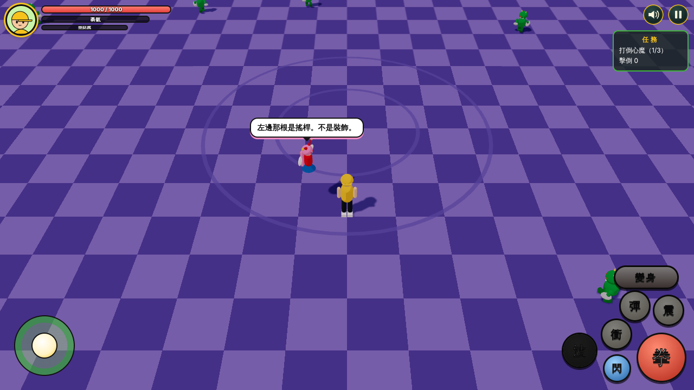
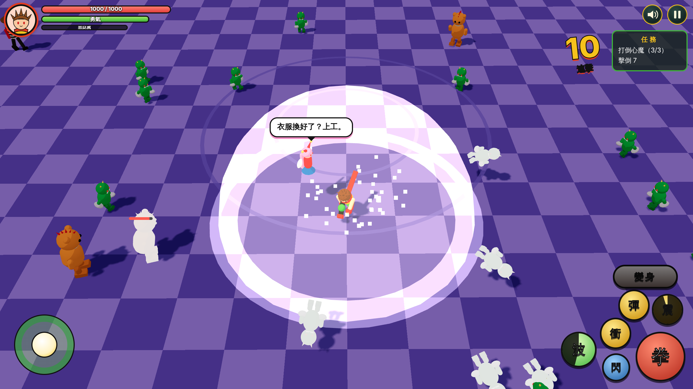
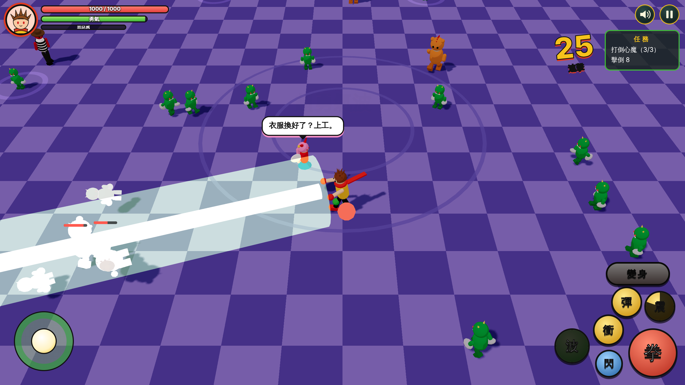

# 勇氣超人：設計底 D1 實作與美術製作需求 v2.0（2026-11-11，Claude）

## 使用者要求
- 開始做設計底 D1。
- 先把架構完工，然後送出美術製作需求。
- 勇氣超人的三小招一大招都要有無雙感，清地圖要爽。
- （用量到了就幫忙重設用量：Claude 做不到，見文末。）

## 完成內容

### 遊戲（`02_xianxia_battle/`）
原型從仙俠佔位版改成《勇氣超人》的核心玩法，功能清單見 [`PROGRESS.md`](../../02_xianxia_battle/PROGRESS.md)。重點：
- `js/main.js` 整個重寫：兩種型態、四條計量、主動變身（可按住拖延 1–3 秒）、罪惡感爆炸強制變身、三小招一大招、三層死亡保險、小天使吐槽、連擊與擊倒數。
- `js/visuals.js`：佔位角色改為大學生、勇氣超人、小天使、小幹譙、假森、佛賴弟；比例改為概念圖的 4–5 頭身。
- `js/world.js`：場景改為紫色格紋地板的夢境大廳。
- `index.html`、`css/game.css`：HUD 改為四條計量與七顆按鍵，配色改為勇氣綠／外套黃／圍巾紅。
- `tools/make_simple_art.py`：暫代圖換成勇氣超人的配色與圖案（拳頭、星、綠色能量球），新增勇氣超人頭像。

### 無雙感
招式範圍與冷卻見企劃書 4.3 新增的表。配套：小怪一波 12–25 隻、同時出手上限 4 隻、被打倒的怪會飛出去。

### 實作中依實測調整的數值（已回寫企劃書 4.8）
- 小拳命中的勇氣 +2 → +1.5（機器人 9 秒就集滿，太快）。
- 變身中靠命中補回的勇氣加上限 50（否則無雙打法會永遠維持變身）。
- 放大招期間不回氣（否則大招的多段命中會立刻把氣補滿）。
- 三個小招的冷卻由 4／6／9 秒改為 3／4.5／7 秒。

### 美術製作需求
[`02_xianxia_battle/assets/ASSETS.md`](../../02_xianxia_battle/assets/ASSETS.md) 重寫為 v2.0：全部改成勇氣超人的內容，含製作順序總表（P0–P3）、角色設定合輯、3D 生成用圖、HUD 與按鍵、品牌、變身演出素材、三張地圖的場景、字藝、數字、特效貼圖、表情、音訊。
**「送出」的實際狀態**：需求文件已提交到 repo。Claude 沒有管道把它傳給 GPT／Codex，也沒有通知任何人；要由使用者交給對方。

## 驗證
見 `PROGRESS.md` 的「驗證」一節。截圖：

## 尚待完成
- 設計底 D2–D5、劇情對話系統（見 `PROGRESS.md`）。
- 使用者：實機試玩並回饋手感與數值；把美術需求交給 GPT；申請 Tripo API 金鑰；BGM 與配音。
- `tools/render_concepts.cjs` 仍輸出舊角色的三視圖，`concept/` 內 17 張為作廢的示範。
- 資料夾名 `02_xianxia_battle` 未改。

## 關於用量
使用者希望用量到上限時由 Claude 自動重設。Claude 沒有任何工具能查看或重設帳號的使用量上限，這是帳號方案層級的設定。工作都已提交並推送，用量重設後傳訊息即可從這裡接續。

## 發布狀態
已提交並推送至分支 `claude/sleepy-pasteur-c8wvjf`；未開 PR、未合併、未部署。
