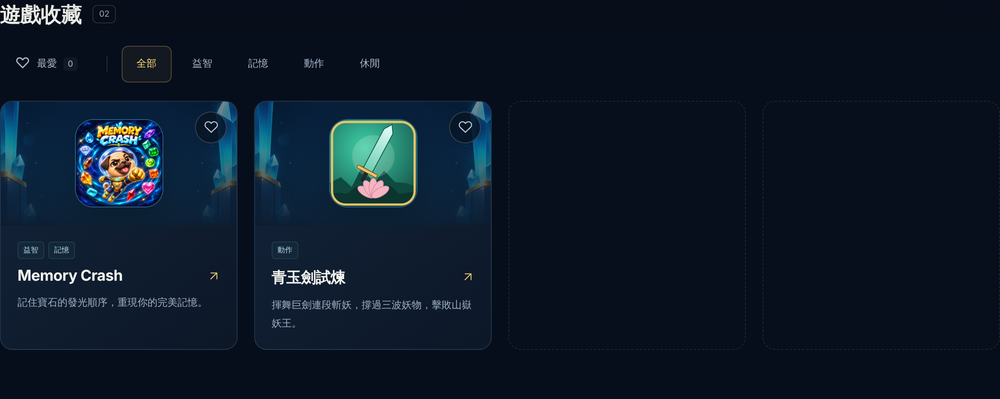
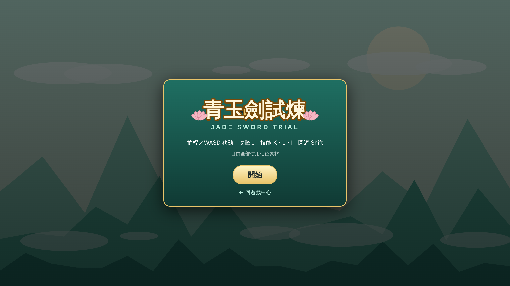
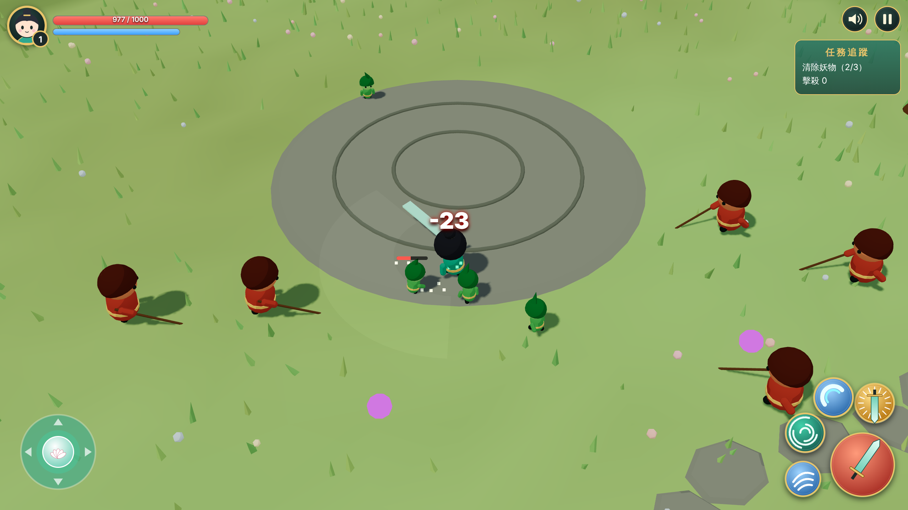
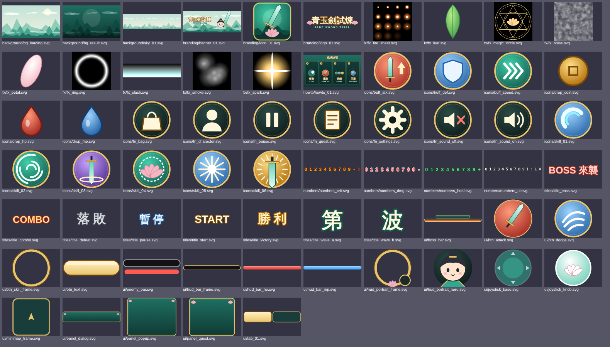

# 第二款遊戲：首頁入口、簡單版美術、美術優先級清單（2026-11-11，Claude）

## 使用者要求
1. 把遊戲做到遊戲總覽頁，加上遊戲入口。
2. 所有美術圖先由 Claude 做一個簡單版本。
3. 開出需要製作的美術清單，要有優先級；Claude 能做的先做，需要其他軟體協作的放後面。

## 完成內容

### 首頁入口
- `assets/js/hub.js`：`GAMES` 新增第二款（id `jade-sword-trial`、分類「動作」、連到 `02_xianxia_battle/`），六種語言各加一句介紹（`description2`）。
- 遊戲名稱**暫定「青玉劍試煉 / Jade Sword Trial」**，是 Claude 為了做入口先取的，使用者尚未確認。
- 首頁大 Banner 仍是 Memory Crash，沒有更動。
- `tools/check_hub.cjs` 配合兩款遊戲更新斷言（空格數、動作分類、多張卡片），並把寫死的 `/workspace/games` 截圖路徑與 Chromium 路徑改成相對／可選。
- `assets/preview/hub_banner_*.png` 三張預覽圖由該工具重新輸出（現在有兩張卡片）。
- 遊戲開始畫面加了「回遊戲中心」連結。

### 簡單版美術（全部為程式繪製的暫代圖）
- `02_xianxia_battle/tools/make_simple_art.py` 產生 **65 張 SVG** 到 `02_xianxia_battle/assets/source/pic/`：
  品牌 3、背景 3、字藝 8、UI 18、圖示 19、數字 4、特效貼圖 9、教學圖 1。總計約 324KB。
- `tools/concept.html`＋`tools/render_concepts.cjs` 把佔位 3D 角色輸出成 **17 張 2048×2048 PNG 三視圖**（`pic/concept/`，約 3MB，瀏覽器原生 PNG 無損輸出，未再壓縮）。
  這些只適合當比例參考，不建議直接送去生 3D。
- 已接進遊戲：開始／結算背景、Logo、頭像、搖桿、攻擊鍵、閃避鍵、三個技能圖示、暫停與靜音圖示、分頁圖示。
- **產出但尚未接進遊戲**：字藝、數字圖集、特效貼圖、教學圖、橫幅、天空、各種框與面板、其餘圖示（清單見 `ASSETS.md` 優先級總表的最後一欄）。
- 簡單版 SVG 直接從 `assets/source/` 引用，沒有另建 `runtime/`；正式 PNG 到位時再依專案慣例建立 runtime 版本。
- 文字類 SVG（Logo、字藝、數字）使用系統字型，不同裝置上字形會略有差異。

### 美術優先級清單
- `02_xianxia_battle/assets/ASSETS.md` 新增「優先級總表」：A 組（Claude 已完成簡單版，11 項）與 B 組（需其他軟體，P0–P3）。
- P0 是主角設定圖與主角 3D 模型（Tripo，需使用者的 API 金鑰）。

### 順手修掉的錯誤
- `js/visuals.js`：`parent.add(child).rotation` 其實改到父物件，導致主角的頭被轉 90°、小怪的長槍方向相反。輸出三視圖時才發現，已修正。前一份報告的截圖是修正前的樣子。

## 驗證（無頭 Chromium＋軟體 WebGL）
- `tools/check_hub.cjs`：PASS（24 種語言×寬度版面、篩選、最愛、儲存異常、連結）。
- 從首頁卡片點進第二款 → 開始 → 戰鬥 → 靜音／暫停切換 → 落敗結算：通過，無 console 錯誤、無載入失敗。
- Boss、勝利、重來回歸測試：通過。
- **未驗證**：實體手機觸控與幀率、聲音聽感、其他瀏覽器（Safari／Firefox）。
- 截圖：   

## 尚待完成
- 使用者：確認或更改遊戲名稱；申請 Tripo API 金鑰；交付 BGM 與配音。
- GPT／使用者：P0 主角設定圖三視圖與巨劍。
- Claude：把未接入的簡單版素材接進遊戲（字藝、數字、特效貼圖、教學畫面）；金鑰到位後跑 Tripo 流程。

## 發布狀態
已提交並推送至分支 `claude/sleepy-pasteur-c8wvjf`；未開 PR、未合併、未部署。首頁入口要等合併並部署後才會出現在正式網站。
